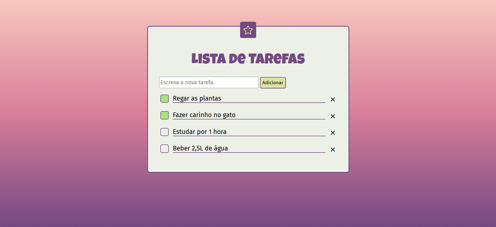

# Lista de Tarefas

API REST de tarefas feita com Node.js e Express, acompanhada de uma interface web em HTML, CSS e JavaScript puros. O projeto cobre um CRUD completo, do servidor até a tela, com validação de dados e tratamento de erros.



## O que ele faz

- Lista, cria, busca, atualiza e remove tarefas
- Marca uma tarefa como concluída pela caixinha, direto na tela
- Recusa títulos vazios e responde com mensagens de erro claras
- Avisa a pessoa na interface quando o servidor rejeita um envio
- Adapta o layout para telas de celular

## Tecnologias

- **Node.js** e **Express** no servidor
- **HTML, CSS e JavaScript** sem framework no front-end, usando `fetch` para falar com a API
- **Google Fonts** (Luckiest Guy e Fira Sans)

## Como rodar

É preciso ter o [Node.js](https://nodejs.org) instalado.

```bash
git clone https://github.com/MaOngaro/api-tarefas.git
cd api-tarefas
npm install
node index.js
```

Depois, abra [http://localhost:3000](http://localhost:3000) no navegador.

## Endpoints

| Método | Rota             | O que faz                    | Respostas        |
|--------|------------------|------------------------------|------------------|
| GET    | `/tarefas`       | Lista todas as tarefas       | 200              |
| GET    | `/tarefas/:id`   | Busca uma tarefa pelo id     | 200, 404         |
| POST   | `/tarefas`       | Cria uma tarefa              | 201, 400         |
| PUT    | `/tarefas/:id`   | Atualiza título e conclusão  | 200, 400, 404    |
| DELETE | `/tarefas/:id`   | Remove uma tarefa            | 204, 404         |

Exemplo de corpo para `POST` e `PUT`:

```json
{
  "titulo": "Regar as plantas",
  "concluida": false
}
```

No `POST`, só o `titulo` é necessário. No `PUT`, o título continua obrigatório e o campo `concluida` define o novo estado. Quando o título falta ou está vazio, a API responde `400` com `{ "erro": "Adicione o título." }`. Quando o id não existe, a resposta é `404`.

## Estrutura do projeto

```
api-tarefas/
├── docs/
│   └── tela.png
├── public/
│   ├── index.html
│   ├── script.js
│   └── style.css
├── routes/
│   └── tarefas.js
└── index.js
```

O Express serve a pasta `public` como vitrine do site, e as rotas da API ficam separadas em `routes/tarefas.js`, ligadas ao servidor com `Router`.

## Decisões e limitações

- **Dados em memória.** As tarefas ficam numa lista dentro do servidor. Ao reiniciar, a lista volta ao começo.
- **Ids que não se repetem.** Um contador separado gera cada id, então apagar uma tarefa nunca faz outra herdar o número dela.
- **Front-end sem framework.** A escolha foi proposital, para praticar manipulação do DOM e eventos na base da linguagem.

## Próximos passos

- Trocar a lista em memória por um banco SQLite
- Cobrir as rotas com testes automatizados (Jest e Supertest)

## Créditos

- Ícone da estrela: [Bootstrap Icons](https://icons.getbootstrap.com), licença MIT
- Fontes: [Google Fonts](https://fonts.google.com)
